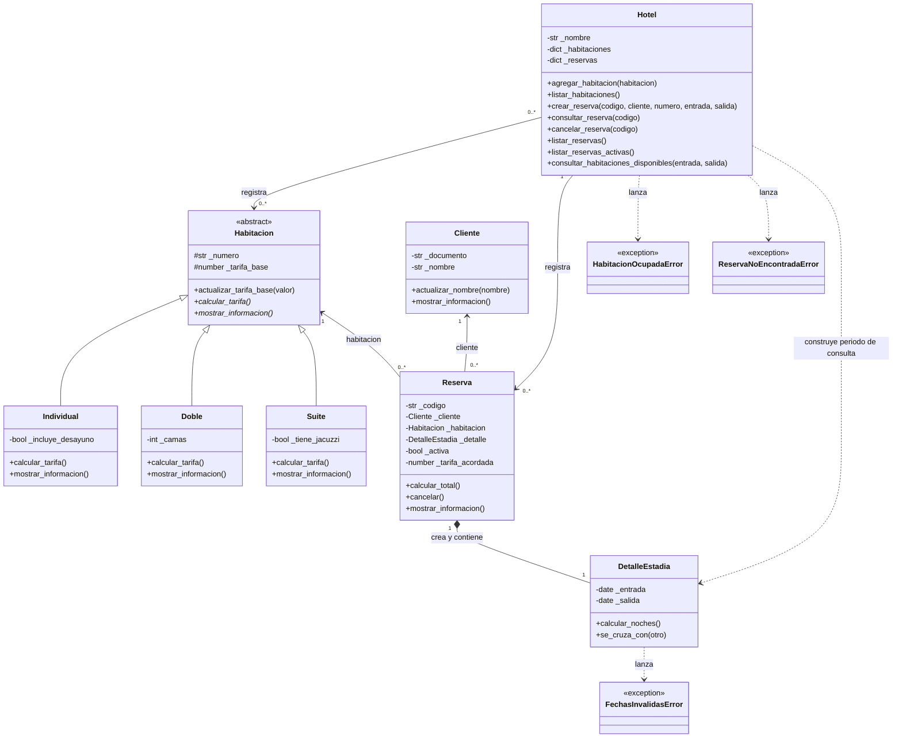

# Diagrama de clases

El diagrama se muestra en GitHub mediante Mermaid. También está disponible como [SVG](UML.svg).
Se omiten las propiedades de lectura para facilitar la lectura; sus nombres corresponden a los
atributos internos sin el prefijo `_`.

El rombo lleno indica composición; la flecha con triángulo indica herencia.
Cada reserva utiliza un cliente, una habitación y su propio detalle. Los intervalos de reservas
activas de una misma habitación no pueden cruzarse. El modelo no impide que la misma habitación
sea registrada en distintas instancias de `Hotel`; la demostración usa un único hotel.
Las tres excepciones heredan de `Exception` en el código; esa clase estándar se omite aquí.
